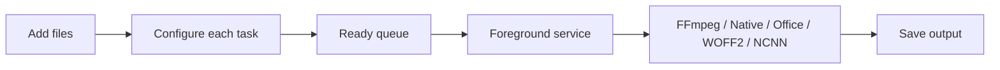

<h1 align="center">ZenConverter</h1>

  <strong>Private, local-first file conversion for Android.</strong>

  English |
  <a href="README_zh.md">中文</a>

  
  
  
  
  
  
  
  
  
  

  
  

  

ZenConverter is a local file converter for Android. Pick a file on your phone,
convert it on your phone, and keep it off someone else's server.

The app is built with native Kotlin and Jetpack Compose. File access goes
through Android's Storage Access Framework, and longer jobs run in a foreground
service. The app deliberately stays narrow: supported routes are verified on a
physical Android device, and their known limits are written down instead of
hidden.

**Note:** very large media files still need adequate free storage, memory, and
power. Keep the device available while a long foreground conversion is running.

  

## Why Build It

Desktop users already have plenty of good open-source converters. Android feels
rougher. Many converter apps are cluttered, ad-heavy, oddly priced, or built
around uploading your file somewhere first.

ZenConverter is the local-first Android converter I wanted to use:

- no network transfer for conversion work,
- no ads, accounts, paywalls, or remote uploads,
- `INTERNET` permission is only used for manual update checks and on-demand model/font downloads,
- no extra permissions unless the app actually needs them,
- large videos are treated as real use cases, even if that path is still rough,
- the support list lives in the public [support matrix](formats/support-matrix.md).

## Current Status

`Stable` routes have been verified on a physical Android device. `Beta` routes
work within the stated compatibility limits.

| Area | Status | Notes |
| --- | --- | --- |
| Video conversion & merge | Stable | MP4 / MKV / MOV (H.264/H.265) and WebM (VP9/VP8) output, always re-encoded with FFmpeg. Adjust codec, bitrate, resolution, frame rate, and audio, or pick a compression preset. Drag to trim or split, and merge several clips into one. |
| Video to GIF | Stable | Uses the first 30 seconds of the selected range, up to 30 fps and 900 frames. Short side defaults to 480 px; 720 px and Original are available. |
| Video contact sheet | Stable | Samples frames from the whole video or a trimmed range into a JPG or PNG sheet. Start from a preset or set rows, columns, sizes, spacing, fit, background (transparent on PNG), info header, watermark, and timestamps yourself. Capped at 100 frames and about 32 MP. |
| Audio extraction and conversion | Stable | Extract audio from video or convert between MP3 / M4A / WAV / FLAC / WMA / OPUS, always re-encoded with FFmpeg. MP3 offers CBR or VBR (V0/V2/V4/V6). MP3, Opus, and FLAC outputs keep tags, cover art, and embedded lyrics, and are checked after writing. |
| Advanced audio/video processing | Stable | Video: reverse (short clips), fade, mirror, rotate, fit/crop, and motion blur. Audio: reverse, noise reduction (`afftdn`), fade, volume/mute, and echo. |
| Video frame interpolation | Beta | Two ways to double the frame rate. Optical flow (FFmpeg `minterpolate`) runs offline with no download, up to 1080p. RIFE AI (NCNN + Vulkan) needs a one-time model download and is experimental because results vary across phone GPUs. |
| Image conversion | Stable | Inputs: JPG / JPEG / JFIF / JPE, PNG, WEBP, GIF, HEIC / HEIF, ICO. Outputs: JPG / JFIF / PNG / WEBP / ICO / PDF. HEIC depends on the device decoder. GIFs can use the first frame or be split into a folder. Metadata and animation timing are not kept. |
| Image super-resolution | Stable | Bilinear 2× / 3× / 4×, or Real-ESRGAN 4× AI models (general, high quality, anime) on the GPU through NCNN + Vulkan. Models download on demand and are SHA-256 checked; large images are processed in tiles. |
| Metadata safety | Stable | A separate privacy tool in Settings. Shows location, capture time, and device info in photos (including HEIC) and videos. JPG / JPEG / JFIF metadata can be removed in place without re-encoding and restored later from a local backup. |
| PDF tools | Stable | Images ↔ PDF, merge, compress (High Quality / Balanced / Small File), export selectable text to TXT / MD, and add or remove a password. No OCR and no password cracking. |
| Office conversion | Beta | DOCX / PPTX / XLSX to PDF, TXT, or MD on the device. Chinese uses system fonts, with optional Noto CJK download. Layout can differ from Office; files are capped at 64 MiB. |
| Font conversion | Stable | Convert between TTF, OTF, WOFF, and WOFF2. The output gets .ttf or .otf to match the font. |
| Subtitle & lyrics conversion | Stable | Convert between SRT, VTT, LRC, and ASS. LRC handles multiple timestamps, `[offset:]`, and GBK/GB18030 Chinese files. |

Also included: import from share/open-with, the gallery, or a whole folder; queue different file types together and set each one separately; share or open results right away. The app supports Material You colors, dark mode with an optional OLED black theme, and English, Simplified/Traditional Chinese, and French.

## Architecture

The UI does not do conversion work. Each task is routed to an engine based on
the input, output, and selected mode:

- `Compatibility`: FFmpeg re-encode path for video/audio targets, GIF output, subtitles (SRT/VTT/ASS), advanced processing, and optical-flow interpolation.
- `Native`: Android platform bitmap/PDF handling, PDFBox-Android (PDF merge/text/security), and pure-Kotlin engines (WOFF, LRC).
- `Office`: Local first-pass Office rendering path for DOCX, PPTX, and XLSX.
- `Font / WOFF2`: Native `google/woff2` engine for WOFF2 compression and decompression.
- `AI Super-Resolution`: Tencent NCNN with Vulkan GPU acceleration for local Real-ESRGAN neural network inference.
- `AI Frame Interpolation`: Tencent NCNN with Vulkan GPU compute acceleration for RIFE 2× video frame interpolation.
- `SafeCache`: fallback for file providers that cannot provide usable descriptors.

More detail lives in [docs/architecture.md](docs/architecture.md) and
[docs/technical-route.md](docs/technical-route.md).

Development setup notes are in [docs/development-setup.md](docs/development-setup.md).

## Translations

ZenConverter welcomes community translations! You can contribute translations without knowing Kotlin or installing Android Studio. See the [English source and translation guide](docs/translating.md) to get started.

## License

ZenConverter's own source code is licensed under the
[GNU Affero General Public License v3.0 or later](LICENSE).

Third-party libraries, native binaries, and bundled fonts keep their own
licenses. Details are tracked in
[docs/license-and-attribution.md](docs/license-and-attribution.md) and
[third_party/THANKS.md](third_party/THANKS.md).

## Acknowledgements

- [OhMyGPT](https://www.ohmygpt.com/) provides AI API support.
- [ForZTN](https://sponsorship.forztn.com/github/Jasonzhu1207/ZenConverter) provides the kernel compilation server.

## Star History

<a href="https://www.star-history.com/?repos=Jasonzhu1207%2FZenConverter&type=date&legend=top-left">
 <picture>
   <source media="(prefers-color-scheme: dark)" srcset="https://api.star-history.com/chart?repos=Jasonzhu1207/ZenConverter&type=date&theme=dark&legend=top-left&sealed_token=P3Zmgn-p92V6guzcZT8ZUwylDekOXKbOFhOleCImzz7mtVs67wn_yDBNrP0ZpawNYMYhz0WumOhO7_GJTo8zTuE8WT1iPgH4TL96SnXGWKW7AvuQP0aQ9MIhXJhDqWtOslPYbAKLRKM_p2o-kmMVitwvHCS9WRShyvQhks3hZmZ0n1tX6e91OCq-pnLk" />
   <source media="(prefers-color-scheme: light)" srcset="https://api.star-history.com/chart?repos=Jasonzhu1207/ZenConverter&type=date&legend=top-left&sealed_token=P3Zmgn-p92V6guzcZT8ZUwylDekOXKbOFhOleCImzz7mtVs67wn_yDBNrP0ZpawNYMYhz0WumOhO7_GJTo8zTuE8WT1iPgH4TL96SnXGWKW7AvuQP0aQ9MIhXJhDqWtOslPYbAKLRKM_p2o-kmMVitwvHCS9WRShyvQhks3hZmZ0n1tX6e91OCq-pnLk" />
   
 </picture>
</a>
