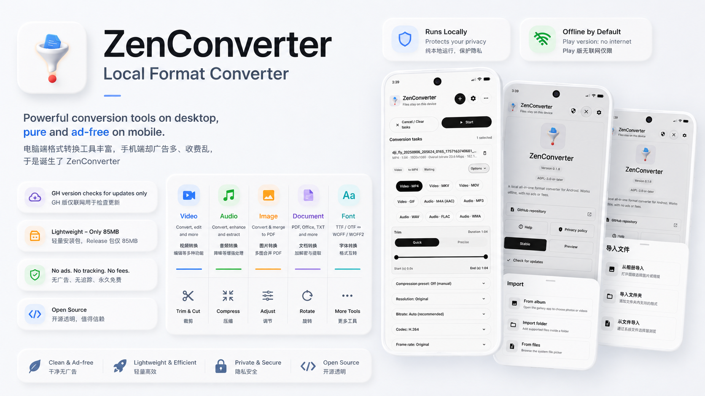
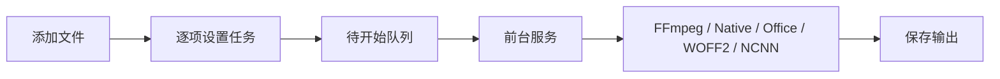

<h1 align="center">ZenConverter</h1>

  <strong>私密、本地优先的 Android 文件转换器。</strong>

  <a href="README.md">English</a> |
  中文

  
  
  
  
  
  
  
  
  
  

  
  

  

ZenConverter 是一个 Android 本地文件转换器。选择手机里的文件，在手机上完成转换，不把文件上传到别人的服务器。

项目使用原生 Kotlin 和 Jetpack Compose。文件访问走 Android Storage Access Framework，耗时任务在前台服务中运行。项目不会假装自己是万能转换器：已支持路线均已在 Android 真机验证，限制也会直接写清楚。

**注意：** 超大媒体文件需要足够的可用存储、内存和电量。长时间前台转换期间请保持设备可用。如出现闪退等情况欢迎及时反馈。

  

## 为什么做它

桌面端已经有很多优秀的开源转换工具，但 Android 端体验仍然粗糙。很多转换类 App 广告多、收费混乱、界面臃肿，或者默认要求把文件上传到云端。

ZenConverter 想做的是一个本地优先的 Android 转换器：

- 转换过程不需要网络传输，
- 没有广告、账号、付费墙或远程上传，
- 仅申请 `INTERNET` 权限用于手动检查应用更新及按需下载 AI 模型/字体，
- 不申请不必要的权限，
- 大视频被当作真实使用场景处理，即使这条路仍然需要继续打磨，
- 支持范围公开写在 [support matrix](formats/support-matrix.md) 中。

## 当前状态

`稳定` 路线已在 Android 真机验证；`Beta` 路线可用，但仍受明确写出的兼容性边界约束。

| 模块 | 状态 | 说明 |
| --- | --- | --- |
| 视频转换与合并 | 稳定 | 输出 MP4 / MKV / MOV（H.264/H.265）和 WebM（VP9/VP8），全部由 FFmpeg 重新编码。可调编码、码率、分辨率、帧率和音频，也可以直接选压缩预设。支持拖动裁剪、多段分割，以及把多个视频合并成一个。 |
| 视频转 GIF | 稳定 | 取所选范围的前 30 秒，最多 30 fps、900 帧。默认短边 480 px，可选 720 px 或原始尺寸。 |
| 视频拼图 | 稳定 | 从整段视频或裁剪范围内均匀取帧，生成 JPG / PNG 拼图。可以用预设，也能自己调行列、尺寸、间距、填充方式、背景（PNG 可透明）、信息头、水印和时间戳。上限 100 帧、约 3200 万像素。 |
| 音频提取与互转 | 稳定 | 从视频提取音频，或在 MP3 / M4A / WAV / FLAC / WMA / OPUS 之间互转，全部由 FFmpeg 重新编码。MP3 支持固定码率或 VBR（V0/V2/V4/V6）。转成 MP3、Opus、FLAC 时保留歌曲信息、封面和内嵌歌词，写入后会回读校验。 |
| 音视频高级处理 | 稳定 | 视频：倒放（限短视频）、淡入淡出、镜像、旋转、画幅适配/裁剪、运动模糊。音频：倒放、降噪（`afftdn`）、淡入淡出、音量/静音、回音。 |
| 视频补帧 | Beta | 两种方式把帧率翻倍。光流补帧（FFmpeg `minterpolate`）完全离线、无需下载，最高 1080p。RIFE AI 补帧（NCNN + Vulkan）需先下载模型，不同手机 GPU 表现差异较大，目前仍是实验性功能。 |
| 图片转换 | 稳定 | 输入：JPG / JPEG / JFIF / JPE、PNG、WEBP、GIF、HEIC / HEIF、ICO。输出：JPG / JFIF / PNG / WEBP / ICO / PDF。HEIC 取决于设备解码器。GIF 可转首帧或拆帧到文件夹。不保留元数据和动画时序。 |
| 图片超分辨率 | 稳定 | 双线性 2× / 3× / 4×，或 Real-ESRGAN 4× AI 模型（通用、高画质、动漫），通过 NCNN + Vulkan 在 GPU 上运行。模型按需下载并校验 SHA-256，大图分块处理。 |
| 元数据安全 | 稳定 | 设置里的独立隐私工具。可查看照片（含 HEIC）和视频里的位置、拍摄时间、设备等信息。JPG / JPEG / JFIF 元数据可不重编码原地清除，之后还能从本地备份恢复。 |
| PDF 工具 | 稳定 | 图片 ↔ PDF、合并、压缩（高画质 / 均衡 / 小体积）、导出可选中文本为 TXT / MD，以及加密和解密。不含 OCR，也不破解密码。 |
| Office 转换 | Beta | DOCX / PPTX / XLSX 本地转 PDF、TXT 或 MD。中文默认用系统字体，也可按需下载 Noto CJK。版式不保证和 Office 一致，文件上限 64 MiB。 |
| 字体转换 | 稳定 | TTF、OTF、WOFF、WOFF2 互转，输出自动按字体类型选 .ttf 或 .otf。 |
| 字幕与歌词转换 | 稳定 | SRT、VTT、LRC、ASS 互转。LRC 支持多时间戳、`[offset:]` 偏移和 GBK/GB18030 编码的中文文件。 |

此外：支持从系统分享/打开方式、相册或整个文件夹导入；不同类型的文件可以放进同一个队列分别设置；转换完可直接分享或打开结果。界面支持 Material You 动态取色、深色模式和 OLED 纯黑，提供简中、繁中、英文、法文。

## 架构

UI 不直接做转换。每个任务会根据输入、输出和所选模式选择引擎：

- `Compatibility`：音视频转换、GIF 输出、字幕转换（SRT/VTT/ASS）、音视频高级处理和光流补帧都走 FFmpeg。
- `Native`：用 Android 平台 API 处理图片、PDF，结合 PDFBox-Android（合并/文本/安全）及纯 Kotlin 引擎（WOFF、LRC）。
- `Office`：用本地初版 Office 渲染路线处理 DOCX、PPTX 和 XLSX。
- `Font / WOFF2`：通过内置 `google/woff2` 原生库处理 WOFF2 字体压缩与解压。
- `AI Super-Resolution`：基于 Tencent NCNN 与 Vulkan GPU 加速在本地运行 Real-ESRGAN 神经网络超分推理。
- `AI Frame Interpolation`：基于 Tencent NCNN 与 Vulkan GPU 加速在本地运行 RIFE 2× 视频补帧推理。
- `SafeCache`：后续用于处理无法提供可用文件描述符的文件来源。

更多细节见 [docs/architecture.md](docs/architecture.md) 和
[docs/technical-route.md](docs/technical-route.md)。

开发环境说明见 [docs/development-setup.md](docs/development-setup.md)。

## 多语言翻译

欢迎参与 ZenConverter 的本地化与多语言翻译！无需了解 Kotlin 或安装 Android Studio。详情请参阅 [英文底稿与翻译贡献指南](docs/translating.md)。

## 许可证

ZenConverter 自有源码基于
[GNU Affero General Public License v3.0 or later](LICENSE) 发布。

第三方库和原生二进制文件仍保留各自许可证。详细记录见
[docs/license-and-attribution.md](docs/license-and-attribution.md) 和
[third_party/THANKS.md](third_party/THANKS.md)。

## 鸣谢

- [OhMyGPT](https://www.ohmygpt.com/) 提供 AI API 支持。
- [ForZTN](https://sponsorship.forztn.com/github/Jasonzhu1207/ZenConverter) 提供内核编译服务器支持。

## Star History

<a href="https://www.star-history.com/?repos=Jasonzhu1207%2FZenConverter&type=date&legend=top-left">
 <picture>
   <source media="(prefers-color-scheme: dark)" srcset="https://api.star-history.com/chart?repos=Jasonzhu1207/ZenConverter&type=date&theme=dark&legend=top-left&sealed_token=P3Zmgn-p92V6guzcZT8ZUwylDekOXKbOFhOleCImzz7mtVs67wn_yDBNrP0ZpawNYMYhz0WumOhO7_GJTo8zTuE8WT1iPgH4TL96SnXGWKW7AvuQP0aQ9MIhXJhDqWtOslPYbAKLRKM_p2o-kmMVitwvHCS9WRShyvQhks3hZmZ0n1tX6e91OCq-pnLk" />
   <source media="(prefers-color-scheme: light)" srcset="https://api.star-history.com/chart?repos=Jasonzhu1207/ZenConverter&type=date&legend=top-left&sealed_token=P3Zmgn-p92V6guzcZT8ZUwylDekOXKbOFhOleCImzz7mtVs67wn_yDBNrP0ZpawNYMYhz0WumOhO7_GJTo8zTuE8WT1iPgH4TL96SnXGWKW7AvuQP0aQ9MIhXJhDqWtOslPYbAKLRKM_p2o-kmMVitwvHCS9WRShyvQhks3hZmZ0n1tX6e91OCq-pnLk" />
   
 </picture>
</a>
